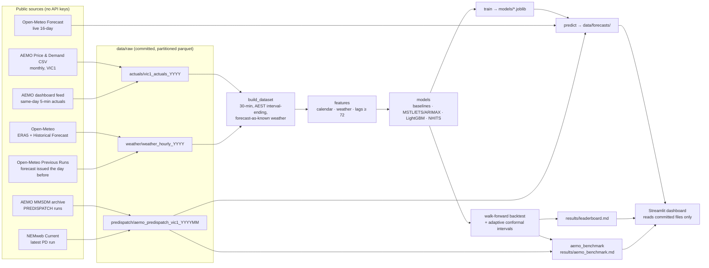

# GridCast — Architecture

## Layers

| Layer | Module(s) | Contract |
|---|---|---|
| Time handling | `utils/aest.py` | Every timestamp is naive **AEST (UTC+10, no DST), interval-ending**. Conversions only at the edges. Unit-tested (summer stamps must not shift). |
| Ingestion | `data/fetch_actuals.py`, `fetch_weather.py`, `fetch_aemo_forecasts.py` | Idempotent and incremental; raw data stored as yearly/monthly parquet partitions; only changed partitions are rewritten. |
| Dataset | `data/build_dataset.py` | One 30-minute table, Nixtla long format (`unique_id, ds, y…`), gap-checked; `weather_regime` records whether each interval's weather was a day-before forecast. |
| Features | `features/*` | Exogenous features (calendar + weather) only use information available at forecast time; target lags are all ≥ the 72-step horizon (direct day-ahead). Leakage is tested. |
| Models | `models/*` | Baselines define the MASE bar; classical models via statsforecast; LightGBM via mlforecast; NHITS optional. |
| Evaluation | `evaluation/*` | Walk-forward only, with a lookahead guard; design chosen on a 2023 validation year; evaluation window scored once. |
| Serving | `train.py`, `predict.py`, `app/` | Models trained offline and committed; the app never fetches data or retrains. |

## Data flow & refresh

| Job | When | Does | Commits |
|---|---|---|---|
| `ci.yml` | PR / push | ruff, pytest, rebuild dataset from committed raw data, smoke backtest | nothing |
| `daily_refresh.yml` | 02:35 UTC = **12:35 AEST** daily | fetch (incremental) → build → predict | `data/forecasts/` (+ live weather file) |
| `daily_refresh.yml` | 3rd of each month / on demand | as above + retrain | + `data/raw/` partitions and `models/` |

Why 12:35 AEST: AEMO's dashboard feed then holds today's actuals to 12:00, and AEMO's 12:30 PREDISPATCH
run is published — so the live forecast follows exactly the backtest protocol and is directly
comparable with AEMO's.

## Design decisions

- [ADR-001 — Direct day-ahead LightGBM (lags ≥ horizon)](docs/adr/ADR-001-direct-day-ahead.md)
- [ADR-002 — Own PREDISPATCH reader instead of nemseer](docs/adr/ADR-002-predispatch-reader.md)
- [ADR-003 — Adaptive conformal intervals](docs/adr/ADR-003-adaptive-conformal.md)
- [ADR-004 — 30-minute grain and day-before weather](docs/adr/ADR-004-grain-and-weather.md)
- Build errata: [CLAUDE.md §16](CLAUDE.md)

## Limitations

- **Single region, single weather point.** Melbourne weather stands in for all of Victoria; regional
  heat (e.g. northern Victoria) is invisible to the model.
- **Operational demand only.** Rooftop PV is not modelled explicitly; its growth is absorbed by the
  trend feature and day-before solar radiation.
- **Price is hard.** Spot price depends on bids, outages and interconnector limits that are not public at
  forecast time; GridCast's price model sees calendar and weather only. AEMO's PREDISPATCH has that
  information — the benchmark shows what it is worth.
- **Preliminary same-day actuals.** The dashboard feed's values can be revised; the monthly CSV supersedes them.
- **Weather history regimes.** Before Feb 2024 some training weather is reanalysis/near-analysis rather
  than a day-before forecast; the evaluation window is entirely day-before forecasts.
