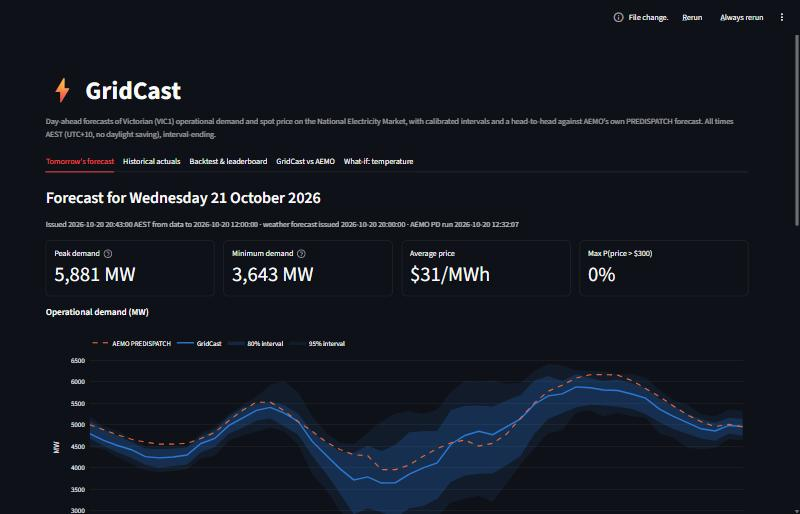
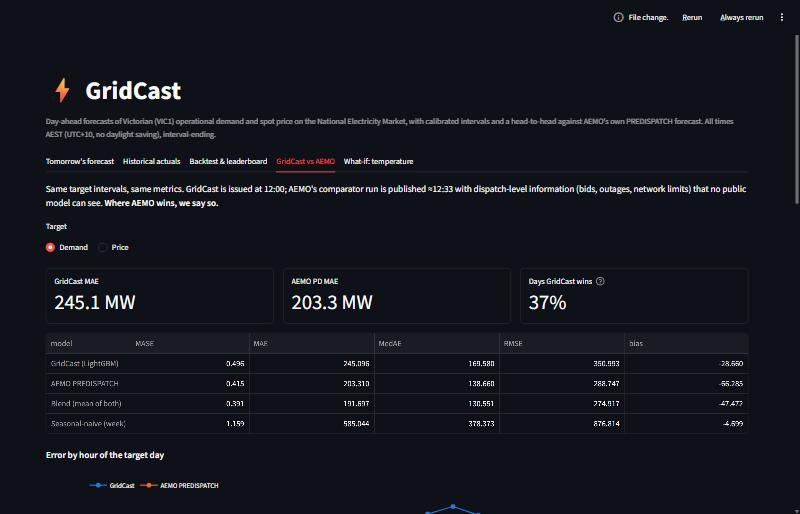
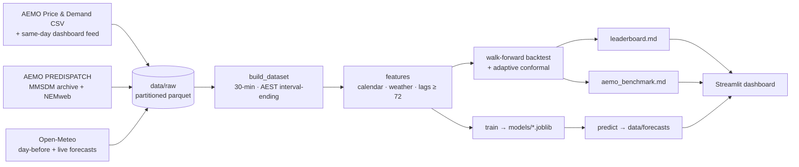

# ⚡ GridCast: day-ahead VIC1 electricity demand & price forecasting

> An end-to-end forecasting system for the Australian National Electricity Market. Every day at
> 12:00 AEST it forecasts Victoria's operational demand and spot price for each half-hour of tomorrow,
> with calibrated prediction intervals and a spike probability. It is scored by walk-forward
> backtesting and compared head-to-head with **AEMO's own PREDISPATCH forecast**.

[](https://github.com/KarthikReddy-Tanigundala/gridcast/actions/workflows/ci.yml)
[](https://github.com/KarthikReddy-Tanigundala/gridcast/actions/workflows/daily_refresh.yml)

| | |
|---|---|
| 📈 Live dashboard | _Streamlit Community Cloud link: added once deployed_ |
| 🏆 Model leaderboard | [results/leaderboard.md](results/leaderboard.md) |
| ⚖️ GridCast vs AEMO | [results/aemo_benchmark.md](results/aemo_benchmark.md) |
| 📚 Methodology · Architecture · Errata | [METHODOLOGY.md](METHODOLOGY.md) · [ARCHITECTURE.md](ARCHITECTURE.md) · [CLAUDE.md §16](CLAUDE.md) |



## 🏆 Results (out of sample, nothing hand-entered)

**972 daily forecasts**, issued at 12:00 AEST from 1 Feb 2024 to 29 Sep 2026. Each covers tomorrow's 48
half-hours, 12.5–36 h ahead. Every weather input is the forecast issued the day before.
**MASE < 1** means the forecast beats a "same half-hour yesterday" rule.

| Target | Model | MASE | MAE | 80% / 95% interval coverage |
|---|---|---|---|---|
| Demand | **GridCast LightGBM** | **0.482** | **235 MW** (sMAPE 5.1%) | **0.798 / 0.947** |
| Demand | Seasonal-naive (same half-hour last week) | 1.159 | 583 MW | 0.796 / 0.947 |
| Demand | Best classical (MSTL-ARIMAX, weekly origins) | 1.285 | 645 MW | — |
| Demand | NHITS deep learning (weekly origins, CPU budget) | 1.081 | 530 MW | — |
| Price | **GridCast LightGBM** | **0.813** | **$43.5/MWh** | **0.798 / 0.948** |
| Price | Seasonal-naive (same half-hour yesterday) | 1.231 | $69.1/MWh | — |

The intervals are calibrated: 80% intervals contain the actual value ~80% of the time, measured
rather than assumed.

Deep learning did **not** beat LightGBM here. NHITS was trained on a laptop-CPU budget (400 steps,
trailing year, quarterly refits) and scored worse than the seasonal-naive. That says more about the
budget and the single-series setting than about NHITS. A well-featured gradient-boosting model is
hard to beat on one series, a common finding that is reported as measured.

### ⚖️ Can a public model match the market operator? (last 12 months, 364 days)

| Target | GridCast | AEMO PREDISPATCH (≈12:33 run) | 50/50 blend | GridCast wins |
|---|---|---|---|---|
| Demand MAE | 245 MW | **203 MW** | **191 MW** | 37% of days |
| Price MAE | **$29.5** | $85.7 | $50.5 | 57% of days |
| Price median abs. error | $21.9 | **$16.9** | $16.9 | — |

**Honest reading:**
- **AEMO wins on demand.** It sees 30 more minutes of data plus dispatch-level inputs. GridCast
  still carries independent information: the blend beats both.
- **Price is two stories.** On a typical half-hour AEMO is better (median error). But AEMO's
  day-ahead PD shows RRP > $300 in 4.5% of half-hours against 0.19% that actually clear there. It
  prices tomorrow on *today's* bids, and participants rebid. So it is a dispatch scenario, not a
  statistical forecast, and its mean error is dominated by phantom spikes.
- **On spikes:** AEMO's PD catches 74% of real ones at 3% precision. GridCast's classifier runs at 36%
  precision and 12% recall: the opposite trade-off.



## 🎯 What makes this different

- ✅ **MASE 0.48 on day-ahead demand**, scored against a proper seasonal-naive bar across 972 days.
- ✅ **Benchmarked against AEMO's official PREDISPATCH**: 12 months, the same intervals, the same
  metrics, plus AEMO's error-vs-lead-time convergence. Where AEMO wins, it says so.
- ✅ **No hindsight weather.** Every evaluation interval uses Open-Meteo's forecast issued the day before (asserted in code).
- ✅ **Calibrated intervals:** rolling split-conformal with adaptive conformal inference, with coverage measured.
- ✅ **Validation-then-test discipline.** Every design choice (lags, trend, objective, interval method)
  was made on a 2023 validation year ([results/validation.json](results/validation.json)) before the
  evaluation window was scored.
- ✅ **A model ladder:** baselines → AutoETS / MSTL-ETS / MSTL-ARIMA(X) → LightGBM → NHITS.
- ✅ **Live and self-updating.** A GitHub Action runs at 12:35 AEST daily (the backtest's own protocol)
  and commits tomorrow's forecast, building a public track record.
- ✅ Free and keyless: AEMO NEMweb plus Open-Meteo, with no API keys.

## 📐 Architecture



## 🌏 Domain notes (the details that silently break NEM models)

- **Time zone.** AEMO time is **AEST = UTC+10 all year**, with interval-*ending* timestamps.
  `Australia/Melbourne` would shift every summer interval by an hour against weather data. Unit-tested
  in `tests/test_aest.py`. (While building this, the machine clock read 21:43 AEDT; the forecast
  correctly reports 20:43 AEST.)
- **5-minute settlement (1 Oct 2021).** The 30-minute price is the mean of six dispatch prices, and
  the regime switch is handled and tested.
- **Negative prices.** VIC1 cleared at or below $0 in **~23% of half-hours** in 2023–2026 (0.7% in 2019).
  So there are no log transforms, an L1 price objective, and no MAPE (undefined at zero).
- **Operational ≠ underlying demand.** `TOTALDEMAND` excludes rooftop PV. Midday demand keeps falling:
  the record low in this data is **1,244 MW on 27 Dec 2025**, below the 1,594 MW record of Dec 2023.
- **Price cap & spikes.** The market price cap is now above $20,000/MWh, and a single PD run showed
  $22,976. Spikes are rare (0.9% of half-hours > $300), so PR-AUC and precision/recall are used, not accuracy.

## 🛠️ Tech stack

| Layer | Tools |
|---|---|
| Data | AEMO NEMweb (Price & Demand CSV, MMSDM PREDISPATCH, dashboard feed), nemosis (alternative path), Open-Meteo |
| Modelling | LightGBM via **mlforecast**, **statsforecast** (AutoETS, MSTL, ARIMA), **neuralforecast** (NHITS, optional) |
| Evaluation | walk-forward backtest, MASE / pinball / coverage, adaptive conformal inference, PR-AUC |
| Serving | Streamlit + Plotly, GitHub Actions (CI + daily refresh) |
| Quality | pytest (timezone, leakage, metrics, backtest integrity, AEMO parser), ruff, pre-commit |

## 🚀 Getting started

```bash
git clone https://github.com/KarthikReddy-Tanigundala/gridcast && cd gridcast
python -m venv .venv && .venv/Scripts/activate     # Windows; use .venv/bin/activate on macOS/Linux
pip install -r requirements.txt && pip install -e .
python -m gridcast.data.build_dataset              # rebuilds the modelling table from committed raw data
streamlit run app/streamlit_app.py
```

Windows users can use `.\make.ps1 <target>` (the twin of the `Makefile`), with targets `fetch`,
`fetch-aemo`, `build`, `backtest`, `benchmark`, `spikes`, `dl`, `train`, `predict`, `refresh`, `app`,
`test` and `lint`.

## 🧪 Reproducing the results

```bash
python -m gridcast.evaluation.backtest --validation   # design selection on 2023
python -m gridcast.evaluation.backtest                # -> results/leaderboard.md (~10 min)
python -m gridcast.evaluation.aemo_benchmark          # -> results/aemo_benchmark.md
python -m gridcast.evaluation.spike_classification
python -m gridcast.models.deep_learning               # optional: pip install -r requirements-dl.txt
pytest
```

## ⚠️ Limitations

- One weather point (Melbourne) for the whole state. Regional heatwaves are under-represented.
- The price model sees calendar, weather and price history only. Bids, outages and network
  constraints are not public at forecast time, and that is exactly where AEMO's PD has its edge.
- Same-day actuals from AEMO's dashboard feed are preliminary until the monthly file supersedes them.
- Before Feb 2024 some *training* weather is near-analysis. The evaluation window is not.
- The what-if tab is a sensitivity tool (temperature only, other weather held fixed), not a causal model.

## 🎓 About

Built by **Karthik Reddy Tanigundala** (RMIT Master of Data Science). It builds on prior production
experience in Australian/NZ retail energy analytics (ReAmped Energy, Electric Kiwi).
LinkedIn: [linkedin.com/in/karthik-reddy-datascience](https://linkedin.com/in/karthik-reddy-datascience) ·
GitHub: [KarthikReddy-Tanigundala](https://github.com/KarthikReddy-Tanigundala)

Data: AEMO (NEMweb), used under AEMO's copyright permissions for public data. Weather: Open-Meteo, CC-BY 4.0.
